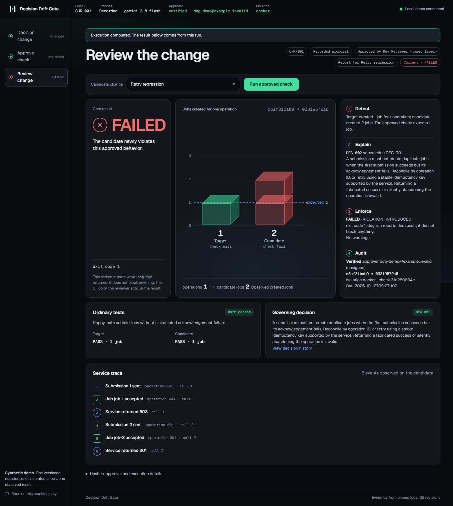
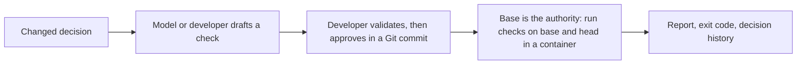

# Decision Drift Gate

Turn changed engineering decisions into developer-approved checks that catch old behavior returning in new code.

**Status (12 October 2026, `master`):** a working tool with a CLI, a GitHub Action, a local browser demo and a container sandbox. The test suite has **370 tests, all passing** in the last full run (host and Docker modes; see [evaluation](docs/EVALUATION.md)). It has been run on one synthetic scenario and a few small test repositories. **No human evaluation has been done and no review-time saving has been measured.** The GitHub Action has been tested offline only; it has not run on GitHub.



## What it does

A team replaces a blanket retry rule after discovering that a request can succeed even when its response fails. A model or a developer drafts a structured behavioral check from the changed decision. A developer validates and approves it. Later code accidentally restores blind retries. Ordinary happy-path tests pass, but the approved check observes two jobs created for one operation and reports the failure with the replacement decision.

A passing result means the approved checks passed for the two recorded code revisions. Nothing more.



## Install

Requirements: Python 3.10 or newer (declared in `pyproject.toml`; only 3.12 has been tested), Git, and for checks that run pull-request code **Docker or Podman**. Without a container runtime, runs end as NOT_CHECKED. They never fall back to the host unless you set `DDG_SANDBOX=host`.

```powershell
python -m pip install .            # core: standard library only
python -m pip install ".[ai]"      # adds the Gemini SDK (only for the gemini_api provider)
python -m pip install ".[bedrock]" # adds boto3 (only for the bedrock provider with AWS credentials)
ddg --help                         # same as: python -m ddg --help
```

Other model providers (Anthropic, OpenAI-compatible servers, Claude Code, Codex and any command) need no extra package. See [model providers](docs/PROVIDERS.md).

## Use it on a real repository

Every command below is exercised by `tests/test_cli_real.py` on a repository with no demo marker.

1. **Initialise.** `ddg init --repo <repo> --approver alice@example.com` writes `.ddg/approvers.json` (`require_signed` is `false` until you edit it) and the `.ddg/decisions/` folder. It refuses to overwrite an existing policy. Commit the result to your base branch and protect it ([threat model](docs/THREAT_MODEL.md)).

   ```json
   {"schema_version": 1, "require_signed": true, "approvers": ["alice@example.com"]}
   ```

2. **Record the decisions.** One JSON file per decision in `.ddg/decisions/<id>.json`. The replaced decision has `"status": "superseded"`; the new one is `"active"` and names it in `supersedes`:

   ```json
   {"schema_version": 1, "id": "DEC-002", "status": "active", "supersedes": "DEC-001",
    "scope": "src/pricing.py", "rule": "discount must reject negative prices with ValueError.",
    "exceptions": ["A zero price is valid and costs nothing."]}
   ```

3. **Propose a check.** Pick the adapter (below). For `python_function_v1`, write the check yourself and run:

   ```powershell
   ddg propose --repo <repo> --adapter python_function_v1 --mode manual --check check.json --out draft.json
   ```

   For `python_job_client_v1` you may use `--mode recorded` (bundled capture) or `--mode live` with a model provider. `--revision <commit>` selects the commit where the new decision is active (default `HEAD`). An example `check.json` is in [tests/test_adapters.py](tests/test_adapters.py) (`CHECK`).

4. **Validate.** Name three commits of your own history: one where the rule is broken, one where it holds, and one with a valid exception:

   ```powershell
   ddg validate --repo <repo> --draft draft.json --out validation.json `
     --calibration-bad <rev> --calibration-good <rev> --calibration-exception <rev>
   ```

   The check must fail on the bad commit and pass on the other two. Exit code 1 means not eligible.

5. **Approve.** `ddg approve --repo <repo> --draft draft.json --validation validation.json --reviewer <name> --reason <text>` writes three files under `.ddg/checks`, `.ddg/validations` and `.ddg/approvals` and prints their paths. It does not commit.

6. **Commit the approval.** An approver commits exactly those three files and nothing else, signed if you require it: `git add .ddg && git commit -S -m "Approve CHK-001"`. DDG checks the Git author, the touched paths and, when `require_signed` is true, the signature. Configure `gpg.ssh.allowedSignersFile` or a GPG keyring on every machine that runs DDG.

7. **Run.** `ddg run --repo <repo> --base <base> --head <head> --out report.json`. The base commit supplies the checks, decisions and approver list. The head commit supplies only the code under test. Add `--sandbox docker|podman|host|auto` to choose isolation and `--format json|md|both` for the report files (default both).

Upgrading from the earlier prototype? See [docs/UPGRADING.md](docs/UPGRADING.md).

## Use it in GitHub Actions

`action.yml` at the root of this repository is a composite action. It installs DDG, runs `ddg run` on the pull request's base and head, uploads the JSON and Markdown report, and posts or updates one PR comment.

```yaml
on: pull_request
permissions: {contents: read, pull-requests: write}
jobs:
  ddg:
    runs-on: ubuntu-latest        # needs Docker for the default sandbox
    steps:
      - uses: actions/checkout@v4
        with: {fetch-depth: 0, persist-credentials: false}
      - uses: ./        # inside this repository; from another repository use <owner>/<repo>@<ref> once published
```

Inputs: `base-ref`, `head-ref` (default: the PR base and head SHAs), `sandbox` (default `docker`), `python-version` (default `3.12`), `fail-on-incomplete` (default `true`), `post-comment` (default `true`). Exit code 1 fails the job; exit code 2 fails it unless `fail-on-incomplete` is `false`; any other code is an error. A fixture workflow is in `.github/workflows/ddg.yml`. Do not run it on fork code in a workflow that has secrets. Not yet verified on GitHub itself: the comment posting and the check conclusion.

## Adapters

An adapter says what a check can observe. The id is part of the approval digest.

| Adapter | What it checks | Proposal source |
|---|---|---|
| `python_job_client_v1` | `submit_job(service, payload, operation_id)` in `src/job_client.py` against a fake service that can fail after creating a job | Model (recorded or live, any provider) or manual |
| `python_function_v1` | One function in one stdlib-only module: return value or exception type for given JSON arguments (up to 50 cases) | Manual only. Model proposals refuse this adapter |

Both adapters run a single stdlib-only Python file. See [architecture](docs/ARCHITECTURE.md).

## Model providers

The model step is optional and only drafts a check; calibration and a human approval still decide whether it is used. Choose a provider with `DDG_PROVIDER` or `--provider`: `gemini_api` (default), `anthropic_api`, `openai_api` (also any OpenAI-compatible server through `OPENAI_BASE_URL`), `bedrock`, `claude_cli`, `codex_cli`, `custom_cli`. The CLI providers use your Claude Code or Codex subscription login instead of an API key. `ddg providers` lists them. Details, variables and limits: [docs/PROVIDERS.md](docs/PROVIDERS.md).

## Reading a report

`run` writes JSON and a Markdown sidecar. The Markdown report starts with:

- **Result:** PASSED_CHECKS, FAILED or INCOMPLETE.
- **Base commit** and **Head commit** (full SHA).
- **Adapter** and **Isolation** (`docker`, `podman`, `host` or `unavailable`). `host` is marked UNSAFE.

Per check, the verdict compares base and head:

| Base | Head | Verdict |
|---|---|---|
| pass | fail | VIOLATION_INTRODUCED |
| fail | fail | PRE_EXISTING_FAILURE |
| fail | pass | RESOLVED |
| pass | pass | CHECK_PASSED |
| error (either side) | any | NOT_CHECKED |

INCOMPLETE also means: a check's approver could not be verified (`APPROVER_NOT_VERIFIED` warning), a bundle or the history is invalid or unreadable, an active decision has no check, or the head edits `.ddg/` policy files. Each reason is in the report warnings. `ddg status` tells you whether a saved report is STALE because a ref moved.

## Exit codes

| Code | Meaning |
|---|---|
| 0 | PASSED_CHECKS |
| 1 | FAILED. Also: `validate` not eligible, `status` stale |
| 2 | INCOMPLETE. The gate could not prove the change safe; never treat it as a pass |
| 3 | Usage or infrastructure error: bad arguments, missing repository, unreadable file, no container runtime, or an unexpected crash |

Earlier versions returned 2 for usage errors. Scripts that treated 2 as "error" must now treat 3 as the error code.

## Environment variables

| Variable | Effect |
|---|---|
| `DDG_SANDBOX` | `auto` (default), `docker`, `podman` or `host`. `host` runs reviewed code on the machine without a container and is marked UNSAFE in reports. `--sandbox` on `run` sets it. |
| `DDG_SANDBOX_IMAGE` | Container image. Default `python:3.12-slim` (a tag, not a digest). A custom image must be pinned as `name@sha256:...` unless `DDG_SANDBOX_ALLOW_UNPINNED=1` is also set. |
| `DDG_ALLOW_UNVERIFIED_APPROVERS` | `1` lets a repository with no `.ddg/approvers.json` run; approvers are marked unverified. Never use it in CI. |
| `DDG_PROVIDER`, `DDG_MODEL`, `DDG_PROVIDER_TIMEOUT` | Model provider, model name and per-call limit (1 to 600 s). See [providers](docs/PROVIDERS.md). |
| `GEMINI_API_KEY`, `DDG_GEMINI_MODEL`, `ANTHROPIC_API_KEY`, `OPENAI_API_KEY`, `OPENAI_BASE_URL`, `AWS_BEARER_TOKEN_BEDROCK`, `DDG_AWS_REGION`, `DDG_CLI_COMMAND` | Provider credentials and settings. Read from the environment or a local `.env` (current directory first). Executing approved checks never needs them. |

## Run the browser demo

The browser interface is a local demo viewer for the synthetic scenario. It binds to this machine only. It draws only what the engine returned: one slab per job actually observed on the target and the candidate, the check's expected count as a dashed marker, and the gate result with its exit code. A missing or errored observation is a hatched "not observed" column, never a zero or a green bar, and the screen states that it does not block anything.

```powershell
ddg demo-init --destination .ddg-demo
ddg serve --repo .ddg-demo --state-dir .ddg-state
```

Open `http://127.0.0.1:8765`. Choose **Draft a check**, select **Recorded proposal**, draft and validate it, then enter a reviewer and review note to approve the exact check. Run **Retry regression**, **Unseen helper regression**, and **Allowed idempotency exception**. The first two fail; the exception passes. If the demo already exists, start only the server; its saved approval and session resume. Use a new destination for another full lifecycle. Stop the server with Ctrl+C.

For the fast pitch, approve beforehand and begin on **Review change**. Disclose that approval was prepared earlier, then click **Run approved check** to execute fresh observations.

## Run the demo from the CLI

The core and Recorded proposal mode need no Python dependencies or provider key. Running the checks needs Docker or Podman (or `DDG_SANDBOX=host` for a trusted local demo).

```powershell
ddg demo-init --destination .ddg-demo
ddg propose --repo .ddg-demo --decision DEC-002 --mode recorded --out .ddg-state/draft.json
ddg validate --repo .ddg-demo --draft .ddg-state/draft.json --out .ddg-state/validation.json
ddg approve --repo .ddg-demo --draft .ddg-state/draft.json --validation .ddg-state/validation.json --reviewer Developer --reason "Reviewed bad, good and stable-key calibration" --commit-demo
ddg run --repo .ddg-demo --base approved-base --head regression --out .ddg-state/report.json
```

Use a new or empty destination; `demo-init` refuses existing content. `--commit-demo` creates the synthetic review branches and commits as `ddg-demo@example.invalid`, which `demo-init` lists in the demo's `.ddg/approvers.json`. Recorded mode uses the bundled capture from a real Gemini call and labels it accordingly. A manual sample needs `--mode manual --check examples/manual_check.json`.

The regression returns exit 1 with one job at base and two at head, while ordinary happy-path observations pass. Inspect `--head exception`, `--head unrelated`, or `--head unseen-regression` for other outcomes.

```powershell
ddg status --repo .ddg-demo --base approved-base --head regression --report .ddg-state/report.json
python -m unittest discover -s tests -v
```

Container tests skip with a visible reason when no runtime exists. The tamper suite (`tests/test_tamper.py`) alone takes about 25 minutes; `python -m unittest discover -s tests -p "test_[!t]*.py"` runs everything else in about 13. After approving a demo you can run the deterministic case matrix: `python scripts/evaluate.py --repo .ddg-demo --out .ddg-evaluation`.

## Limitations

- **Model drafting covers one adapter.** Only `python_job_client_v1` accepts model proposals. `python_function_v1` checks are written by hand.
- **Target code is one stdlib-only module.** Both adapters run a single Python file that imports only the standard library. They do not understand arbitrary repositories, packages or all engineering decisions.
- **The container is the security boundary, not the verdict's proof.** It limits network, filesystem writes, memory, CPU, processes and privilege for the host. It does not stop kernel or runtime escapes, and the static import screen is best-effort only. A revision under test can still return fabricated results for its own function, so DDG catches accidental regressions, not a determined malicious author. Read the [threat model](docs/THREAT_MODEL.md).
- **Identity depends on your Git setup.** Author email is forgeable unless `require_signed` is true and signing keys are configured. A malicious approver or a compromised base branch is out of scope.
- **Repositories must be ordinary SHA-1 Git repositories with full history.** SHA-256 repositories are rejected, shallow clones fail closed for approval history, and symlinks or submodules under `.ddg/` or at the checked source path make the run INCOMPLETE or NOT_CHECKED. Very large diffs are truncated for display only.
- **No human evaluation yet.** No participant has used DDG in a comparison, and no review-time saving has been measured. The original 50% review-time reduction remains an unmeasured target. The acceptance matrix is a small authored set, not an independent benchmark.

## Documents

- [Threat model](docs/THREAT_MODEL.md), [security policy](SECURITY.md), [changelog](CHANGELOG.md), [upgrade note](docs/UPGRADING.md)
- [Architecture](docs/ARCHITECTURE.md), [model providers](docs/PROVIDERS.md), [evaluation](docs/EVALUATION.md), [evidence provenance](evidence/README.md), [human evaluation protocol](docs/HUMAN_EVALUATION.md)
- [End-to-end tests](tests/e2e/README.md), [productization plan](docs/PRODUCTIZATION_PLAN.md), [phase status](docs/phases/STATUS.md), [delivery checklist](docs/DELIVERY_CHECKLIST.md)
- [Owner's walkthrough](WALKTHROUGH.md), [pitch and demo script](docs/PITCH_AND_DEMO.md), [phased execution roadmap](PHASES.md)
- [Design specification](docs/superpowers/specs/2026-10-03-decision-drift-gate-design.md), [implementation plan](docs/superpowers/plans/2026-10-03-decision-drift-gate.md) (historical; written before the sandbox, adapters, identity and providers)

GitHub repository: [Yashjain329/Decision-Drift-Gate](https://github.com/Yashjain329/Decision-Drift-Gate).
