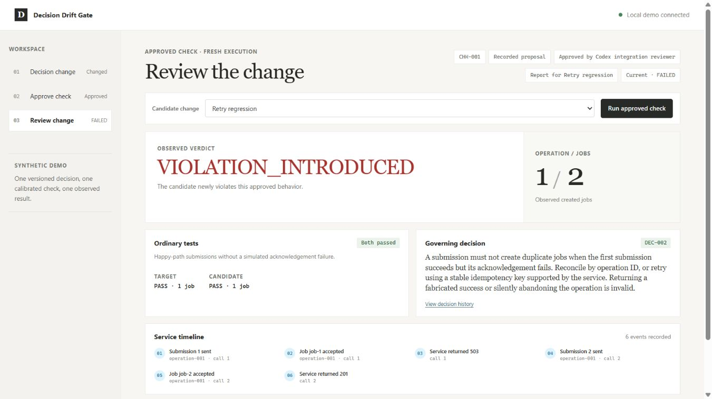
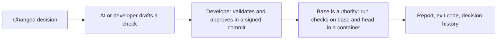

# Decision Drift Gate

Turn changed engineering decisions into developer-approved checks that catch old behavior returning in new code.

**Status (12 October 2026):** a CLI and local browser prototype that is being turned into a tool for real repositories. At commit `bbb0e33` the suite has **144 tests** and the synthetic acceptance matrix has 15 cases (15/15 matched in the last recorded run, on an earlier commit; see [evidence](evidence/README.md)). Container isolation, two adapters and Git-based approver identity are in the code. Packaging, the real-repository CLI and the GitHub Action are being added; see [As of this release](#as-of-this-release-depends-on-parallel-work). No human evaluation has been done.



## What it does

A team replaces a blanket retry rule after discovering that a request can succeed even when its response fails. AI reads the changed decision and drafts a structured behavioral check. A developer validates and approves it. Later code accidentally restores blind retries. Ordinary happy-path tests pass, but the approved check observes two jobs created for one operation and reports the failure with the replacement decision.

A passing result means the approved checks passed for the two recorded code revisions. Nothing more.



## Install

Requirements: Python 3.12 or newer and Git. The core uses only the Python standard library.

For checks that run code from a pull request you also need **Docker or Podman**. Without one, runs end as NOT_CHECKED (they do not fall back to the host).

Today you run DDG from a source checkout:

```powershell
python -m ddg --help
```

A `ddg` command installed with pip is planned (see below).

## Flow for a real repository

Each step says whether it works today.

1. **Initialise.** Create `.ddg/decisions/` with decision records, and `.ddg/approvers.json`:

   ```json
   {"schema_version": 1, "require_signed": true, "approvers": ["alice@example.com"]}
   ```

   Merge it to your base branch and protect it (see [threat model](docs/THREAT_MODEL.md)). A `ddg init` command that writes this for you is **planned**. Today you create the files by hand. The decision record shape is in `ddg/contracts.py`; `python -m ddg demo-init` shows a working example.
2. **Propose.** `python -m ddg propose --repo <repo> --decision <id> --mode manual --check <file.json> --out <draft.json>` (works today). `--mode recorded` and `--mode live` only support the `python_job_client_v1` adapter. Use `manual` for `python_function_v1`.
3. **Validate.** `python -m ddg validate --repo <repo> --draft <draft.json> --out <validation.json>` runs the check against known bad, good and exception revisions. **Today this reads those revisions from the generated-demo marker `.ddg-demo.json`, so it only works on demo repositories.** The `--calibration-*` flags that name your own revisions are **planned**.
4. **Approve.** `python -m ddg approve --repo <repo> --draft <draft.json> --validation <validation.json> --reviewer <name> --reason <text>` writes the three files under `.ddg/checks`, `.ddg/validations` and `.ddg/approvals` (works today). It does not commit them (`--commit-demo` is for demos only).
5. **Commit the approval, signed.** An approver commits exactly those three files and nothing else, for example `git add .ddg && git commit -S -m "Approve CHK-001"`. DDG rejects approval commits that touch other paths, that have an author outside `approvers.json`, or (when `require_signed` is true) that have no good signature. Configure `gpg.ssh.allowedSignersFile` or a GPG keyring on the runner.
6. **Run.** `python -m ddg run --repo <repo> --base <base> --head <head> --out <report.json>` (works today). The base commit supplies the checks, decisions and approver list. The head commit supplies only the code under test.
7. **Run in CI.** A GitHub Action is **planned**. Until then, call the command above in your own workflow with full history (`fetch-depth: 0`), on a runner with Docker or Podman.

Upgrading from the prototype? See [docs/UPGRADING.md](docs/UPGRADING.md).

## Adapters

An adapter says what a check can observe. The id is part of the approval digest.

| Adapter | What it checks | Proposal source |
|---|---|---|
| `python_job_client_v1` | `submit_job(service, payload, operation_id)` in `src/job_client.py` against a fake service that can fail after creating a job | AI-assisted (recorded or live Gemini), or manual |
| `python_function_v1` | One function in one stdlib-only module: return value or exception type for given arguments | Manual only. AI proposals refuse this adapter (`tests/test_adapters.py::test_ai_proposals_refuse_non_job_adapters`) |

Both adapters need a single stdlib-only module. See [architecture](docs/ARCHITECTURE.md).

## Reading a report

`run` writes JSON and a Markdown sidecar. The Markdown report starts with:

- **Result:** PASSED_CHECKS, FAILED or INCOMPLETE.
- **Base commit** and **Head commit** (full SHA).
- **Adapter** and **Isolation** (`docker`, `podman`, `host` or `unavailable`). `host` is marked UNSAFE.

Per check, the verdict compares base and head:

| Base | Head | Verdict |
|---|---|---|
| pass | fail | VIOLATION_INTRODUCED |
| fail | fail | PRE_EXISTING_FAILURE |
| fail | pass | RESOLVED |
| pass | pass | CHECK_PASSED |
| error (either side) | any | NOT_CHECKED |

INCOMPLETE also means: a check's approver could not be verified (`APPROVER_NOT_VERIFIED` warning), a bundle is invalid, an active decision has no check, or the head edits `.ddg/` policy files. Each INCOMPLETE reason is in the report warnings. Run `python -m ddg status` to learn whether a saved report is STALE because a ref moved.

## Exit codes

`python -m ddg run` returns:

| Code | Meaning |
|---|---|
| 0 | PASSED_CHECKS |
| 1 | FAILED |
| 2 | INCOMPLETE |

Today any usage or I/O error also returns 2 (`ddg/cli.py`), so 2 is ambiguous. **Planned:** exit code 3 for usage or infrastructure errors, so that 2 means only INCOMPLETE. `validate` returns 1 when the draft is not eligible; `status` returns 1 when a report is stale.

## Environment variables

| Variable | Effect | Where |
|---|---|---|
| `DDG_SANDBOX` | `auto` (default), `docker`, `podman` or `host`. `host` runs reviewed code without a container and is recorded as UNSAFE. | `ddg/sandbox.py` |
| `DDG_SANDBOX_IMAGE` | Container image. Default `python:3.12-slim`. Prefer a digest-pinned image. | `ddg/sandbox.py` |
| `DDG_ALLOW_UNVERIFIED_APPROVERS` | `1` lets a repository with no `.ddg/approvers.json` run; approvers are marked unverified. Do not use in CI. | `ddg/identity.py` |
| `GEMINI_API_KEY`, `DDG_GEMINI_MODEL` | Live proposal mode only. Read from `.env`. Executing approved checks never needs them. | `ddg/proposal.py` |

## As of this release (depends on parallel work)

These items are being added by other work in the same batch. They are **not in the code at `bbb0e33`**. After merge, verify each with `python -m ddg --help` and the file list.

- `pyproject.toml` and a `ddg` console script
- `ddg init`
- `--calibration-*` flags on `validate` (your own bad/good/exception revisions)
- `--sandbox` and `--format` flags
- Exit code 3 for usage or infrastructure errors
- A GitHub Action (checkout of base and head, `ddg run`, report upload, PR comment, check conclusion)
- Edge-case hardening and end-to-end tests

The README sections above that mention these items will need the "planned" marks removed.

## Run the browser demo

Create a new synthetic repository and start the server:

```powershell
python -m ddg demo-init --destination .ddg-demo
python -m ddg serve --repo .ddg-demo --state-dir .ddg-state
```

Open `http://127.0.0.1:8765`. Choose **Draft a check**, select **Recorded proposal**, draft and validate it, then enter a reviewer and review note to approve the exact check. Run **Retry regression**, **Unseen helper regression**, and **Allowed idempotency exception**. The first two fail; the exception passes. For live generation, start the server with the optional virtual-environment Python after the setup below.

If the demo already exists, start only the server; its saved approval and session resume. Use a new destination for another full lifecycle. Stop the server with Ctrl+C. It binds to this machine only.

For the fast pitch, approve beforehand and begin on **Review change**. Disclose that approval was prepared earlier, then click **Run approved check** to execute fresh observations. Hashes, approval and execution details remain available in the evidence drawer.

## Run the demo from the CLI

The core and Recorded proposal mode need no Python dependencies or provider key.

```powershell
python -m ddg demo-init --destination .ddg-demo
python -m ddg propose --repo .ddg-demo --decision DEC-002 --mode recorded --out .ddg-state/draft.json
python -m ddg validate --repo .ddg-demo --draft .ddg-state/draft.json --out .ddg-state/validation.json
python -m ddg approve --repo .ddg-demo --draft .ddg-state/draft.json --validation .ddg-state/validation.json --reviewer Developer --reason "Reviewed bad, good and stable-key calibration" --commit-demo
python -m ddg run --repo .ddg-demo --base approved-base --head regression --out .ddg-state/report.json
```

Use a new or empty destination; demo-init refuses existing content. `--commit-demo` creates the synthetic review branches and commits as `ddg-demo@example.invalid`, which `demo-init` lists in the demo's `.ddg/approvers.json`. Recorded mode uses the bundled capture from a real Gemini call and labels it accordingly. A manual sample requires `--mode manual --check examples/manual_check.json`.

The regression returns exit 1 with one job at base and two at head, while ordinary happy-path observations pass. Inspect `--head exception`, `--head unrelated`, or `--head unseen-regression` for other outcomes.

```powershell
python -m ddg status --repo .ddg-demo --base approved-base --head regression --report .ddg-state/report.json
python -m unittest discover -s tests -v
```

Status reports CURRENT or STALE without changing saved execution evidence. A stale report requires a fresh run. Container tests skip with a visible reason when no runtime exists, and the demo run itself needs Docker or Podman (or `DDG_SANDBOX=host` for a trusted local demo).

## Live Gemini setup

Live generation is optional; executing approved checks works offline.

```powershell
python -m venv .venv
.\.venv\Scripts\python.exe -m pip install -r requirements-ai.txt
if (-not (Test-Path -LiteralPath .env)) { Copy-Item -LiteralPath .env.example -Destination .env }
```

If `.env` already exists, edit it instead of copying over it. Fill `GEMINI_API_KEY` locally and choose `DDG_GEMINI_MODEL`, the provider model identifier. The verified capture used `gemini-3.8-flash` with SDK `2.28.0`; model availability depends on the provider/account. Keep the key out of chat and Git.

```powershell
.\.venv\Scripts\python.exe -m ddg propose --repo .ddg-demo --decision DEC-002 --mode live --out .ddg-state/live-draft.json
```

Live mode calls Gemini and never silently switches to a recorded fixture on failure. Each interaction has a 30-second caller deadline; one schema/citation repair can require a second interaction. Choose Recorded explicitly if the provider is slow or unavailable. A proposal remains unapproved until successful calibration and explicit review.

## Limitations

- **One adapter is AI-assisted, the other is manual.** Only `python_job_client_v1` has AI proposals (recorded and live Gemini). `python_function_v1` checks are written by hand.
- **Target code is one stdlib-only module.** Both adapters run a single Python file that imports only the standard library. They do not understand arbitrary repositories, packages or all engineering decisions.
- **Isolation is a container.** It limits network, filesystem writes, memory, CPU, processes and privilege. It does not stop kernel or runtime escapes. The static import screen is best-effort only. Read the [threat model](docs/THREAT_MODEL.md).
- **Identity depends on your Git setup.** Author email is forgeable unless `require_signed` is true and signing keys are configured. A malicious approver or a compromised base branch is out of scope.
- **No human evaluation yet.** No participant has used DDG in a comparison, and no review-time saving has been measured. The original 50% review-time reduction remains an unmeasured target. The acceptance matrix is a small authored set, not an independent benchmark.

## Documents

- [Threat model](docs/THREAT_MODEL.md), [security policy](SECURITY.md), [changelog](CHANGELOG.md), [upgrade note](docs/UPGRADING.md)
- [Architecture](docs/ARCHITECTURE.md), [evaluation](docs/EVALUATION.md), [evidence provenance](evidence/README.md), [human evaluation protocol](docs/HUMAN_EVALUATION.md)
- [Productization plan](docs/PRODUCTIZATION_PLAN.md), [phase status](docs/phases/STATUS.md), [delivery checklist](docs/DELIVERY_CHECKLIST.md)
- [Owner's walkthrough](WALKTHROUGH.md) (written for the prototype; parts such as "not a security sandbox" are out of date), [pitch and demo script](docs/PITCH_AND_DEMO.md), [phased execution roadmap](PHASES.md)
- [Design specification](docs/superpowers/specs/2026-10-03-decision-drift-gate-design.md), [implementation plan](docs/superpowers/plans/2026-10-03-decision-drift-gate.md)

After approving a demo, run the deterministic case matrix:

```powershell
python scripts/evaluate.py --repo .ddg-demo --out .ddg-evaluation
```

Results preserve expected and observed outcomes, revisions, check digests, metrics and errors. The timing CSV stays empty until actual human measurements are collected.

GitHub repository: [Yashjain329/Decision-Drift-Gate](https://github.com/Yashjain329/Decision-Drift-Gate).
