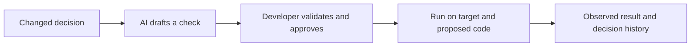

# Decision Drift Gate

Turn changed engineering decisions into developer-approved checks that catch old behavior returning in new code.

**Status:** foundation, real Gemini proposal, approval, review engine and CLI verified; 96 tests passed. Browser demo is in progress. **Hackathon:** selected for the top 25 from 125 entries, as reported by the team. **Next-round deliverables:** live demo, documentation, and GitHub source repository. **Planning date:** 3 October 2026.

## What we will demonstrate

A team replaces a blanket retry rule after discovering that a request can succeed even when its response fails. AI reads the changed decision and drafts a structured behavioral check. A developer validates and approves it. Later code accidentally restores blind retries. Ordinary happy-path tests pass, but the approved check observes two jobs created for one operation and reports the failure with the replacement decision.

The first adapter covers one synthetic Python job client. It does not claim to understand arbitrary repositories or all engineering decisions. A passing result means the approved check passed for the recorded code revisions.



## Read these first

- [Phased execution roadmap](PHASES.md): five phases with GPT 6.1 Sol High orchestrating and GPT 6 Luna implementing.
- [Phase status](docs/phases/STATUS.md): actual dispatch, review and completion evidence.
- [Design specification](docs/superpowers/specs/2026-10-03-decision-drift-gate-design.md): scope, architecture, check format, approval, failure states, and evidence requirements.
- [Implementation plan](docs/superpowers/plans/2026-10-03-decision-drift-gate.md): ordered tasks, interfaces, executable test examples, and release gates.
- [Pitch and demo script](docs/PITCH_AND_DEMO.md): 20-second pitch, browser storyboard, longer walkthrough, and judge questions.
- [Team delivery checklist](docs/DELIVERY_CHECKLIST.md): owners, evaluation method, documentation, and GitHub submission requirements.

These documents define the current approved-check direction. Earlier proposal and critique files in the parent folder are historical context.

## Build choices

Python 3.12 or newer, Git, standard-library execution and tests, and a small local browser interface. Gemini drafts structured JSON through an optional provider adapter. Once a check is approved, executing it does not require an LLM or internet connection. The browser and command line call the same engine.

The CLI lifecycle is implemented and verified. The browser interface follows in Phase 04.

## Run the CLI

Run from this source checkout with Python 3.12+ and Git installed. The core and Recorded proposal mode require no Python dependencies or provider key.

```powershell
python -m ddg demo-init --destination .ddg-demo
python -m ddg propose --repo .ddg-demo --decision DEC-002 --mode recorded --out .ddg-state/draft.json
python -m ddg validate --repo .ddg-demo --draft .ddg-state/draft.json --out .ddg-state/validation.json
python -m ddg approve --repo .ddg-demo --draft .ddg-state/draft.json --validation .ddg-state/validation.json --reviewer Developer --reason "Reviewed bad, good and stable-key calibration" --commit-demo
python -m ddg run --repo .ddg-demo --base approved-base --head regression --out .ddg-state/report.json
```

Use a new or empty destination; demo-init refuses existing content. Approval is an explicit local attestation and creates the synthetic review branches. Recorded mode uses the bundled capture from a real Gemini call and labels it accordingly. A manual sample requires `--mode manual --check examples/manual_check.json`.

The regression returns exit 1 with one job at base and two at head, while ordinary happy-path observations pass. Reports include JSON evidence and a readable Markdown sidecar. Run exit codes are passed checks=0, failed=1 and incomplete=2. Inspect `--head exception`, `--head unrelated`, or `--head unseen-regression` for other outcomes.

```powershell
python -m ddg status --repo .ddg-demo --base approved-base --head regression --report .ddg-state/report.json
python -m unittest discover -s tests -v
```

Status reports CURRENT or STALE without changing saved execution evidence. A stale report requires a fresh run.

## Live Gemini setup

Live generation is optional; executing approved checks works offline.

```powershell
python -m venv .venv
.\.venv\Scripts\python.exe -m pip install -r requirements-ai.txt
if (-not (Test-Path -LiteralPath .env)) { Copy-Item -LiteralPath .env.example -Destination .env }
```

If `.env` already exists, edit it instead of copying over it. Fill `GEMINI_API_KEY` locally and choose `DDG_GEMINI_MODEL`, the provider model identifier. The verified capture used `gemini-3.8-flash` with SDK `2.28.0`; model availability depends on the provider/account. Keep the key out of chat and Git.

```powershell
.\.venv\Scripts\python.exe -m ddg propose --repo .ddg-demo --decision DEC-002 --mode live --out .ddg-state/live-draft.json
```

Live mode calls Gemini and never silently switches to a recorded fixture on failure. A proposal remains unapproved until successful calibration and explicit review.

## Evidence and limits

Read [architecture](docs/ARCHITECTURE.md), [capture provenance](evidence/README.md), and [human evaluation protocol](docs/HUMAN_EVALUATION.md). The supported demo is one synthetic Python adapter and the DEC-001 → DEC-002 replacement. It is not an arbitrary-repository sandbox or authenticated approval service. No human review-time savings or measured pitch duration have been established.

## Why use it

The proposed value is less effort turning a changed decision into a maintained check, and a clearer explanation when later code breaks it. Existing tests, decision records, and AI reviewers are the baseline. We must measure the additional value; the original 50% review-time reduction remains an experimental target.

GitHub repository: [Yashjain329/Decision-Drift-Gate](https://github.com/Yashjain329/Decision-Drift-Gate).
