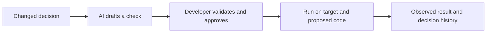

# Decision Drift Gate

Turn changed engineering decisions into developer-approved checks that catch old behavior returning in new code.

**Status:** concrete design and implementation plan; application code and measured results are not yet available. **Hackathon:** selected for the top 25 from 125 entries, as reported by the team. **Next-round deliverables:** live demo, documentation, and GitHub source repository. **Planning date:** 3 October 2026.

## What we will demonstrate

A team replaces a blanket retry rule after discovering that a request can succeed even when its response fails. AI reads the changed decision and drafts a structured behavioral check. A developer validates and approves it. Later code accidentally restores blind retries. Ordinary happy-path tests pass, but the approved check observes two jobs created for one operation and reports the failure with the replacement decision.

The first adapter covers one synthetic Python job client. It does not claim to understand arbitrary repositories or all engineering decisions. A passing result means the approved check passed for the recorded code revisions.

## Read these first

- [Design specification](docs/superpowers/specs/2026-10-03-decision-drift-gate-design.md): scope, architecture, check format, approval, failure states, and evidence requirements.
- [Implementation plan](docs/superpowers/plans/2026-10-03-decision-drift-gate.md): ordered tasks, interfaces, executable test examples, and release gates.
- [Pitch and demo script](docs/PITCH_AND_DEMO.md): 20-second pitch, browser storyboard, longer walkthrough, and judge questions.
- [Team delivery checklist](docs/DELIVERY_CHECKLIST.md): owners, evaluation method, documentation, and GitHub submission requirements.

These documents define the current approved-check direction. Earlier proposal and critique files in the parent folder are historical context.

## Build choices

Python 3.12 or newer, Git, standard-library execution and tests, and a small local browser interface. Gemini drafts structured JSON through an optional provider adapter. Once a check is approved, executing it does not require an LLM or internet connection. The browser and command line call the same engine.

Run commands in the implementation plan describe the intended application; they will become available as the corresponding tasks are completed.

## Why use it

The proposed value is less effort turning a changed decision into a maintained check, and a clearer explanation when later code breaks it. Existing tests, decision records, and AI reviewers are the baseline. We must measure the additional value; the original 50% review-time reduction remains an experimental target.

GitHub repository: [Yashjain329/Decision-Drift-Gate](https://github.com/Yashjain329/Decision-Drift-Gate).
