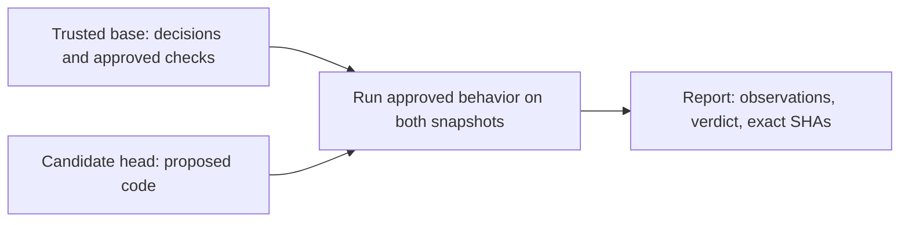

# Decision Drift Gate: owner's walkthrough

Updated: 5 October 2026.

This guide explains the current prototype, who controls each step, and what happens when something goes wrong. Start here before following the detailed design or phase plans.

## 1. What are we building?

Decision Drift Gate (DDG) turns a changed engineering decision into a developer-approved behavior check. It then compares two saved versions of code to detect whether the rejected behavior has returned.

Our demo is about retries. A job creation request succeeds, but its response is lost and the caller receives a `503` error. Blindly retrying creates two jobs. The new decision says to reconcile the result or reuse a stable idempotency key, which identifies the same operation across retries. A request rejected before creating any job still permits a retry.

The demo follows this sequence:

1. `DEC-001` describes the old retry rule. `DEC-002` replaces it.
2. AI proposes a structured check and quotes the decision that supports it.
3. Calibration tests the proposal against known bad and good implementations.
4. A developer reviews and approves the exact check.
5. DDG runs that approved check against the trusted code and proposed code.
6. The report shows what happened, the exact code versions, and the decision behind the check.

AI drafts the check. The developer gives it authority. Later execution uses deterministic observations and does not call AI.

| Available now | What that means |
| --- | --- |
| Local command line and browser interface | Both use the same engine. The browser runs on this computer. |
| Live, Recorded, and Manual proposals | Live calls Gemini. Recorded reuses a labeled real capture. Manual accepts a supplied check file. |
| Validation and explicit approval | A draft is not an approved rule. |
| Local Git comparison | DDG reads saved commits from a local repository. |
| JSON and Markdown reports | Reports preserve the observations and code identifiers. |
| One synthetic Python job-client adapter | The prototype supports this specific behavior and source layout. |

Automatic GitHub repository onboarding, PR comments, GitHub check runs, and merge blocking are not implemented. DDG does not understand arbitrary repositories yet.

## 2. There are two different repositories

This distinction prevents most setup confusion.

### A. The DDG source repository

This is the project on GitHub: [Yashjain329/Decision-Drift-Gate](https://github.com/Yashjain329/Decision-Drift-Gate).

Your local checkout contains the tool itself:

```text
decision-drift-gate/
  ddg/                 Engine, CLI, browser server, approvals, Git access
  web/                 Browser interface
  tests/               Tests for the DDG implementation
  scripts/             Evaluation runner
  examples/            Manual check example
  evidence/            Captures and verification evidence
  docs/                Architecture, pitch, evaluation, phase records
  PHASES.md            Execution roadmap
  WALKTHROUGH.md       This guide
```

Source changes belong in this repository's commits and PRs. At the time of writing, its configured remote is `origin` and its working branch is `master`.

### B. The generated demo repository

`demo-init` creates a separate local Git repository inside a chosen folder:

```text
.ddg-demo-owner/
  .git/                Independent demo history and branches
  src/job_client.py    The code being checked
  .ddg/                Decisions and, after approval, check records
  .ddg-demo.json       Local demo metadata
```

It contains synthetic good and bad code versions. It does not automatically inherit the source repository's GitHub remote.

The source repository ignores `.ddg-demo*/`, `.ddg-state*/`, `.ddg-evaluation/`, `.env`, and `.venv/`. Demo commits stay inside the demo repository.

`--repo .ddg-demo-owner` means “check this local demo repository.” It is not a GitHub URL. Pointing `--repo` at the DDG source checkout does not automatically protect DDG's own code. The adapter expects its supported job-client layout and approved policy records.

## 3. How Git access works

A **commit** is a saved snapshot. A **branch** is a name that points to a commit and can move. A **SHA** is the identifier for one exact commit. A **remote** is a named connection to another repository, such as `origin` on GitHub.

### Getting the source

For a new machine, open PowerShell in the parent folder and run:

```powershell
git clone https://github.com/Yashjain329/Decision-Drift-Gate.git decision-drift-gate
Set-Location decision-drift-gate
git remote -v
git status
```

If the checkout already exists, open that checkout instead of cloning over it. Inspect local work with `git status` before pulling changes. `git fetch origin` downloads remote commits without merging them into your current branch.

GitHub access uses your normal Git credentials. An accessible public repository permits cloning without write access. Private access and pushing require an authorized GitHub account through configured HTTPS credentials or SSH. DDG provides no GitHub login screen. See GitHub's [remote repository guide](https://docs.github.com/en/get-started/git-basics/about-remote-repositories).

`GEMINI_API_KEY` authenticates Gemini calls. It does not grant GitHub access. Do not put GitHub tokens or provider keys in remote URLs, check files, reports, or commits.

### What DDG reads and writes

| Action | Reads | Writes or changes |
| --- | --- | --- |
| Clone, fetch, push | Your Git commands access the remote | Normal Git operations, outside DDG |
| `demo-init` | Bundled demo definitions | Creates a local demo repository and synthetic commits |
| `propose` | Decision text at a selected commit | Writes a draft to `--out`. Live mode also contacts Gemini. |
| `validate` | Draft and demo calibration versions | Writes validation evidence to `--out` |
| `approve` | Draft, decision, validation, and fresh calibration results | Writes check/validation/approval records under the monitored repository's `.ddg/`. The decision already exists. |
| `approve --commit-demo` | Same approval inputs plus demo metadata | Also creates a demo approval commit and review branches |
| `run` | Committed policy at base and committed code at both versions | Writes reports and temporary execution files. Does not commit, merge, or push. |
| `status` | Saved report and current local references | Reports freshness. Does not rewrite the saved report. |

DDG uses local Git commands. It does not automatically clone, fetch, poll GitHub, or push. Without `--commit-demo`, approval writes files but does not create a Git commit. The current validation workflow depends on the generated demo's calibration metadata, so removing that flag does not turn the prototype into generic repository onboarding.

## 4. Run your first complete demo

Run these commands from the DDG source checkout. Install Python 3.12 or newer and Git first. Recorded mode needs no provider credentials or extra Python packages.

The examples use `python`. If Windows opens its Python runtime manager instead of starting an installed interpreter, use the existing virtual environment directly. On this checkout, `.\.venv\Scripts\python.exe` was verified as Python 3.12.4 while preparing this guide. For example:

```powershell
.\.venv\Scripts\python.exe -m ddg --help
```

Replace `python` with that path in the commands below. A fresh clone does not contain `.venv`, so it still needs an installed Python interpreter. This avoids depending on PowerShell activation settings.

Use a fresh folder for a new lifecycle:

```powershell
python -m ddg demo-init --destination .ddg-demo-owner
python -m ddg serve --repo .ddg-demo-owner --state-dir .ddg-state-owner --port 8766
```

Open `http://127.0.0.1:8766`.

1. Open **Draft a check** and choose **Recorded proposal**.
2. Generate the draft. Read the decision quotation and proposed behavior.
3. Validate it. The blind retry must fail. The corrected and stable-key implementations must pass.
4. Enter your reviewer name and a meaningful review note. Approve the check.
5. Open **Review change** and run **Retry regression**. It fails because head creates two jobs.
6. Run **Unseen helper regression**. The behavior still fails even though the code is written differently.
7. Run **Allowed idempotency exception**. It passes.
8. Inspect the evidence drawer for commit SHAs, approval details, observations, and errors.

Stop the server with Ctrl+C. To resume this same demo, run only the `serve` command. To repeat drafting and approval from the beginning, use another fresh destination and state directory.

### Command-line alternative

Use this instead of the browser lifecycle above. This example uses another fresh demo to avoid approving an already approved session:

```powershell
python -m ddg demo-init --destination .ddg-demo-cli-owner
python -m ddg propose --repo .ddg-demo-cli-owner --decision DEC-002 --mode recorded --out .ddg-state-cli-owner/draft.json
python -m ddg validate --repo .ddg-demo-cli-owner --draft .ddg-state-cli-owner/draft.json --out .ddg-state-cli-owner/validation.json
python -m ddg approve --repo .ddg-demo-cli-owner --draft .ddg-state-cli-owner/draft.json --validation .ddg-state-cli-owner/validation.json --reviewer RepoOwner --reason "Reviewed decision, bad case, corrected case and stable-key case" --commit-demo
python -m ddg run --repo .ddg-demo-cli-owner --base approved-base --head regression --out .ddg-state-cli-owner/report.json
```

The last command returns exit code `1`. That is the expected regression result, not a setup failure. It also writes a Markdown report beside the JSON report.

For a passing comparison:

```powershell
python -m ddg run --repo .ddg-demo-cli-owner --base approved-base --head exception --out .ddg-state-cli-owner/exception.json
```

### Optional live AI

Follow [Live Gemini setup in README](README.md#live-gemini-setup). `DDG_GEMINI_MODEL` is the provider's model identifier. Keep the actual key in the ignored local `.env` file. Live mode needs the optional dependencies and the virtual environment's Python.

A provider error does not silently switch the proposal to Recorded mode. Select Recorded explicitly if needed. Either mode still requires validation and approval.

## 5. What base and head mean

**Base** is the trusted version containing the approved decisions and checks. **Head** is the candidate code version being reviewed.



DDG resolves both references to exact commit SHAs for each run. It reads committed files from those snapshots. Unsaved, untracked, and staged-but-uncommitted edits are not part of the comparison.

All active approved checks run against both versions, including when the candidate change looks unrelated. This checks behavior instead of guessing risk from a changed line.

DDG compares the selected endpoints. It does not scan each intermediate commit, automatically choose a common ancestor with `git merge-base`, or resolve merge conflicts. The caller is responsible for choosing the trusted target and candidate correctly.

### Try your own candidate inside the demo

After approving `.ddg-demo-cli-owner`:

```powershell
git -C .ddg-demo-cli-owner switch -c owner-change approved-base
```

Edit `.ddg-demo-cli-owner/src/job_client.py`, then save and commit it:

```powershell
git -C .ddg-demo-cli-owner add src/job_client.py
git -C .ddg-demo-cli-owner commit -m "Try a candidate job-client change"
python -m ddg run --repo .ddg-demo-cli-owner --base approved-base --head owner-change --out .ddg-state-cli-owner/owner-change.json
```

The CLI accepts your custom branch. The browser's scenario picker exposes the bundled scenarios, not every local branch. Running a comparison does not require checking out either branch.

### When a result becomes stale

A saved report applies to its recorded SHAs. If either selected branch moves, run again:

```powershell
python -m ddg status --repo .ddg-demo-cli-owner --base approved-base --head regression --report .ddg-state-cli-owner/report.json
```

`CURRENT` means the supplied local references still match the report. `STALE` means they no longer match or cannot be resolved. This is not a GitHub freshness check. Fetch remote updates before reviewing a remote PR. Passing the old exact SHAs back to `status` cannot reveal that an upstream branch has moved.

## 6. Approval is separate from proposing a change

The approval records bind the exact decision, check, adapter, and validation evidence through a content digest. Editing those approved inputs invalidates that binding. A reviewer name is a local attestation, not an authenticated GitHub identity or a digital signature.

The current approval step runs calibration again and verifies the submitted evidence. Merely changing a validation JSON file to say “passed” does not establish authority.

Base supplies authority. Candidate code cannot authorize its own new check, remove a base check, or rewrite the old decision to make itself pass.

If head changes anything under `.ddg/`, the report requires policy review and becomes `INCOMPLETE`. Existing valid base checks still run. Missing approval, invalid records, an uncovered active decision, or an inconsistent decision replacement history also prevents a complete passing result.

When a decision replaces an older one, the active replacement needs approved coverage. The engine does not keep applying the superseded decision as an active rule.

### How an intentional decision change is handled

Treat a policy change separately from an ordinary code change:

1. Review the new decision and its reason.
2. Define and validate the new behavior check.
3. Obtain explicit approval for the exact new inputs.
4. Establish those records in a trusted policy baseline.
5. Review candidate code against that trusted baseline.

The prototype demonstrates this setup in the synthetic demo. It does not implement a complete GitHub policy-update acceptance workflow. A normal DDG comparison will not automatically accept a `.ddg/`-changing PR. GitHub's **Approve** button and DDG's approval record are separate actions.

## 7. How commits and PRs are handled

A **pull request (PR)** asks reviewers to merge one branch into another. There are two workflows to keep separate.

### A. Changing the DDG tool itself

For source development, use a focused branch and a normal GitHub PR. This is the owner's workflow, not an operation that DDG performs automatically.

```powershell
git status
git fetch origin
git switch -c feature/describe-your-change
```

Make the change. Check the diff, run the relevant tests, and stage explicit files:

```powershell
git diff
python -m unittest discover -s tests -v
git add path/to/changed-file.py
git commit -m "Describe the behavior changed"
git push -u origin feature/describe-your-change
```

Replace the example branch and file path with your actual names. Create a PR on GitHub against the intended target branch, currently `master`. Include the problem, resulting behavior, test results, and any limits. The owner or designated reviewer decides whether to merge it.

Do not stage `.env`, generated demo repositories, or local session state. Ignored files can still be force-added, so inspect the staged diff with `git diff --cached` before committing.

During Codex implementation, [AGENTS.md](AGENTS.md) assigns coordination and Git staging to the orchestrator. Luna execution agents own their assigned source changes. The orchestrator reviews actual changes and verification evidence before accepting a phase. Keep staging and commits serialized in the shared checkout so workers do not mix unrelated changes.

### B. Reviewing code with DDG

Today the owner supplies local base and head references and runs DDG manually. DDG does not accept a PR URL or publish its report back to GitHub.

For the supported demo, use `approved-base` and one candidate branch as shown above. For a future supported repository with established trusted policy, a manual GitHub PR fetch has this shape:

```powershell
# Example only: replace the path, target branch and PR number.
# This repository must already have a supported adapter and trusted policy.
$repoPath = 'D:\path\to\supported-repository'
git -C $repoPath fetch origin
git -C $repoPath fetch origin pull/123/head:review/pr-123
$baseSha = git -C $repoPath rev-parse origin/master
$headSha = git -C $repoPath rev-parse review/pr-123
python -m ddg run --repo $repoPath --base $baseSha --head $headSha --out .ddg-state/pr-123/report.json
```

Run the Python command from the DDG source checkout. Use the actual PR target instead of assuming `master`. Use a fresh local review branch name when fetching a rewritten PR. GitHub documents the PR fetch syntax in [checking out PRs locally](https://docs.github.com/en/pull-requests/how-tos/review-pull-requests/checking-out-pull-requests-locally).

Read the report together with normal tests and code review. A passing report covers the approved checks on those exact snapshots. It does not prove that the PR is safe in every other respect.

After a new push, rebase, squash, target-branch update, or conflict resolution, fetch and run again against the new exact versions. Do not reuse the old report as evidence for a new commit.

### Future automatic PR integration

The next integration needs a GitHub App or CI workflow that fetches the exact target and candidate commits, loads authority from the trusted target, runs the supported checks, stores the report, and publishes a status tied to the candidate SHA. It also needs reruns when relevant references move.

The owner then configures a required status through GitHub's [protected branch settings](https://docs.github.com/en/repositories/configuring-branches-and-merges-in-your-repository/managing-protected-branches/about-protected-branches). The current DDG prototype neither creates that status nor configures those settings.

Execution of unknown PR code needs an isolated runner with appropriate limits. The current local subprocess is not a security sandbox. Do not run fork code in a privileged workflow with secrets. GitHub explains this risk in its [pull_request_target security guidance](https://docs.github.com/en/actions/reference/security/securely-using-pull_request_target). Approved-check execution needs no Gemini key.

Keep automated execution separate from policy approval. A PR that edits the policy must not grant itself authority.

## 8. How to read a result

| Check at base | Check at head | Meaning |
| --- | --- | --- |
| Pass | Fail | Candidate introduced a violation. |
| Fail | Fail | Violation already exists. It still produces a failed aggregate result. |
| Fail | Pass | Candidate resolved that violation. Other checks and coverage still matter. |
| Pass | Pass | This approved behavior passes in both snapshots. |
| Execution error at either version | Any result | Check is not fully checked. Aggregate is incomplete. |

| Aggregate result | Meaning | `run` exit code |
| --- | --- | --- |
| `PASSED_CHECKS` | Required coverage is valid and checked behavior passes or is resolved | `0` |
| `FAILED` | A fully checked violation is introduced or remains present | `1` |
| `INCOMPLETE` | Authority, coverage, policy review, or execution prevents a complete verdict | `2` |

Incomplete takes precedence when the run has both a failure and missing evidence. Read individual observations as well as the aggregate.

Setup errors also return `2`. An invalid Git reference can stop the command before a report exists. `status` has different semantics: `0` means current and `1` means stale.

“Ordinary tests pass” in the demo refers to this adapter's no-fault, happy-path observations. It does not mean DDG has executed every test in the monitored repository or checked GitHub CI.

## 9. Edge cases and recovery

### Setup, Git, and commits

| Situation | Behavior and next action |
| --- | --- |
| Clone says repository not found or access denied | Check the URL and account permissions. DDG cannot grant repository access. |
| `python` or `git` is unavailable | Install the required tool and reopen PowerShell. Check `python --version` and `git --version`. |
| Windows Python runtime manager tries to download a runtime and fails | Use an already installed interpreter, such as this checkout's `.\.venv\Scripts\python.exe`. For a fresh machine, install Python before creating a virtual environment. |
| Git refuses a source commit because author identity is missing | Set this checkout's `git config user.name "Your Name"` and `git config user.email "your-address"`, then retry. Git author metadata is separate from GitHub login. |
| `demo-init` destination already contains files | It refuses to overwrite them. Resume the existing demo or choose a new destination. |
| Another server uses the port | Stop that server or select another `--port`, such as `8767`. |
| Code was edited but not committed | DDG reads the old committed code. Save and commit the candidate before running. |
| A branch or commit does not exist locally | Fetch the needed history or correct the reference. A shallow clone can need more history. |
| PR was force-pushed or rebased | Fetch it into a fresh review reference and rerun. The old SHA report remains historical evidence. |
| Target branch moved | Fetch the new target and rerun. A current candidate SHA alone is insufficient. |
| PR has merge conflicts | Resolve conflicts through normal Git review, then rerun the resulting commit. DDG does not merge it. |
| Several commits are in a PR | DDG compares the selected endpoints. An intermediate violation later reverted is not a per-commit finding. |
| Base and head are the same commit | Valid coverage can pass. This proves no behavior change between those snapshots. |
| Repository uses SHA-256 Git object IDs | Current commit validation expects 40-character SHA-1 IDs. The demo explicitly creates a SHA-1 repository. |

### Drafts, approvals, and policy

| Situation | Behavior and next action |
| --- | --- |
| Live API is unavailable or slow | Live fails explicitly. Each interaction has a 30-second caller deadline, and one repair interaction is allowed. Choose Recorded explicitly for the demo. |
| Recorded capture does not match decision inputs | The mismatch is rejected. Use matching inputs or create a new live/manual proposal. |
| Draft is malformed or its quotation does not match | It is rejected. Correct the proposal and validate again. |
| Known bad code passes calibration | The proposal is not eligible for approval. Fix the check design. |
| Known good or stable-key code fails calibration | Approval is not eligible. Investigate the false failure. |
| Draft or validation was edited after calibration | Approval verifies the inputs and reruns calibration. Regenerate consistent evidence. |
| `--commit-demo` is used with dirty demo files | Activation refuses the unsafe state, including untracked files. Inspect `git -C <demo> status`. Preserve needed work and retry from a clean demo. |
| Demo was copied or moved | Its metadata records the original absolute location. Create a fresh demo at the new location for a new full lifecycle. |
| Demo already has an approved baseline | Reapproval/overwrite is refused. Reuse the approval for runs or create a fresh demo for drafting. |
| Candidate adds, edits, or deletes `.ddg/` records | Policy review is required and the result is incomplete. Candidate policy cannot replace trusted base authority. |
| Base has no valid approvals or active coverage | Result is incomplete. There is no empty green result. |
| Approval digest is forged or decision history is inconsistent | Authority is invalid. Establish valid reviewed records before relying on a result. |
| A historical decision's check is superseded | It is marked historical and ignored as an active rule. The replacement decision still needs valid approved coverage. |
| Policy write is interrupted | Inspect the demo's Git status and records. Do not assume a partial write is valid approval. A fresh demo is the simplest recovery for this prototype. |

### Execution, browser, and evidence

| Situation | Behavior and next action |
| --- | --- |
| Candidate crashes, times out, or lacks the supported entry point | Evidence is incomplete. Fix the implementation and run again. Each worker observation has a 10-second timeout, not a 10-second limit for the whole run. |
| Candidate returns fake success or silently aborts | Correctness also checks the operation outcome. One recorded job alone does not make the behavior valid. |
| Candidate change appears unrelated | Active checks still run on both versions. |
| Supported source rules reject an import or code shape | This adapter has bounded capabilities. Adapt the supported client or extend the adapter through reviewed source work. |
| One check fails and another cannot execute | Aggregate is incomplete. The failure remains visible in individual evidence. |
| Browser shows a restored session | It resumes saved state. Check report freshness and run again when local references changed. |
| Browser rejects a write with a conflict | Another operation or an already approved lifecycle can prevent it. Refresh the session and inspect its current state. |
| Browser request is rejected for host, origin, or session token | Use the local browser URL and normal UI. The server restricts local write requests. It is not a public deployment. |
| Report output is under the monitored `.ddg/` folder | Output is refused to protect policy records. Use a separate state folder and a `.json` report path. |
| Evaluation output is inside the monitored repository | The evaluation runner requires output outside that entire repository. Use `.ddg-evaluation` beside the demo folder in the source checkout. |
| Human timing CSV contains only headers | No human timing measurements exist yet. Do not report time savings from it. |
| Server was stopped | Saved evidence remains on disk. Restart `serve` to use the UI. |
| A secret was accidentally committed | Revoke or rotate the credential. Remove it from tracked files and coordinate any history cleanup with the owner. Adding `.gitignore` does not remove existing commits. |

## 10. Who owns what?

| Responsibility | Owner |
| --- | --- |
| GitHub access and merge permissions | Repository owner and GitHub administrators |
| Engineering decision and intended exceptions | Team making that decision |
| Check approval | Named reviewer who reads the proposal and calibration evidence |
| Choosing trusted base and candidate head | Person running the comparison, or the future trusted integration |
| Implementing DDG changes | Assigned execution agents/developers |
| Coordinating shared edits, commits, phase acceptance | Orchestrator, under [AGENTS.md](AGENTS.md) |
| Merge decision today | Human PR reviewer, using DDG evidence with normal review and tests |
| Live API credentials | Account owner, stored locally and excluded from Git |
| Claims about testing and measured benefits | Team, backed by actual evidence |

For source behavior, start with [architecture](docs/ARCHITECTURE.md). Git reads live in `ddg/gitio.py`, authority and comparison in `ddg/engine.py`, approval in `ddg/approval.py`, demo history in `ddg/demo.py`, report freshness in `ddg/report.py`, and browser state in `ddg/web.py`.

## 11. What is verified, and what remains?

The recorded release verification reports 110 passing tests and 15/15 matching acceptance cases. A fresh GitHub clone reproduced the Recorded lifecycle, local server, and case matrix without provider credentials. These are existing release records, not a claim that every command was rerun while writing this guide. See [phase status](docs/phases/STATUS.md), [release handoff](docs/phases/handoffs/PHASE_05.md), and [evidence provenance](evidence/README.md).

Human review-time measurements, timed pitch rehearsals, and the final submission video remain pending in those records. The proposed 50% review-time saving is a target, not a measured result. GitHub automation and arbitrary-repository support remain future work.

Before presenting, prepare an approved demo, run the regression and permitted exception, check the report SHAs, and choose whether the proposal is Live or Recorded. If approval was prepared beforehand, say so. Follow the [pitch and demo script](docs/PITCH_AND_DEMO.md) and [delivery checklist](docs/DELIVERY_CHECKLIST.md).

Before merging any real change, confirm the intended target and candidate commits, read authority and execution errors, run normal tests, and obtain normal human review. Today DDG supplies evidence. The owner controls the merge.
