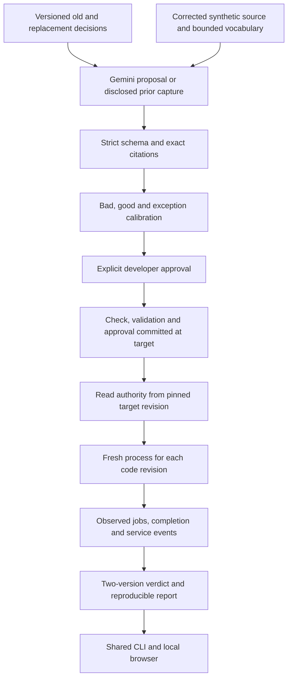

# Decision Drift Gate architecture

This document describes the approved design. [Phase status](phases/STATUS.md) records which components have actually passed verification.

AI proposes a check once. A developer calibrates and approves that exact proposal. Subsequent review results come from executing the approved check against fixed Git revisions; they do not require a model call.

## Authority and evidence

The target revision supplies decisions, checks, validation and approval. The proposed revision supplies the code being reviewed. Changes to policy at the proposed revision require policy review and make aggregate coverage incomplete; they cannot silently remove an existing check.

Canonical UTF-8 JSON and SHA-256 bind the check, governing decision, adapter version and validation. Approval records a local reviewer and reason. This binds content; it is not an authenticated identity or digital signature. The containing approval commit is recorded externally because a commit cannot contain its own final hash.

Proposal provenance records mode, model, capture time and source revision separately from its input-content digest. A real capture can be replayed only when the old/new decisions, corrected source and vocabulary match. Replay is labeled Recorded. A handwritten sample is labeled Manual.

## Bounded adapter

The first adapter runs trusted synthetic `src/job_client.py` with `submit_job(service, payload, operation_id)`. The fake service can create a job before returning 503, or reject it before creating one. Checks observe unique jobs and whether the returned ID actually exists. Completion is mandatory: avoiding duplicates by abandoning the operation does not pass.

Each revision executes in a fresh subprocess with a fresh service and a timeout. Unsupported source, missing entrypoints, crashes and malformed child output are errors. Model credentials are excluded from child environments. This is process separation for the demo, not a sandbox for arbitrary repositories.

## Result semantics

| Target | Proposed | Result |
|---|---|---|
| Pass | Fail | Violation introduced |
| Fail | Fail | Preexisting failure |
| Fail | Pass | Resolved |
| Pass | Pass | Approved check passed |
| Error | Any | Not checked |
| Any | Error | Not checked |

Missing authority, uncovered active decisions, policy edits and execution errors make the aggregate incomplete. Otherwise an introduced or preexisting failure makes it failed. A passed aggregate means the covered approved checks passed for the recorded revisions.

All active approved checks run on both revisions, including unrelated changes. Ordinary happy-path tests also execute; their badge is derived from observations. Changed lines provide review context rather than a claim of exact causal attribution.

## Local application

Python's standard library supplies Git orchestration, tests, subprocess execution, JSON persistence and the local HTTP server. Plain HTML, CSS and JavaScript display the same application functions as the CLI. Gemini's SDK is an optional dependency used only for live proposal generation.

The browser binds to loopback, uses a session action token and local-origin checks, bounds request bodies and serializes mutations. Session state and generated demo repositories are ignored by source Git. The source repository contains the fixture generator, not nested generated Git histories.

Live interactions have a 30-second caller deadline in addition to SDK network timeouts. A daemon worker transfers only a result or exception through a queue; a late response cannot create a proposal or mutate session state. The caller may make one repair interaction after invalid schema/citations. Provider failures are sanitized and require explicit Recorded selection rather than automatic fallback.
