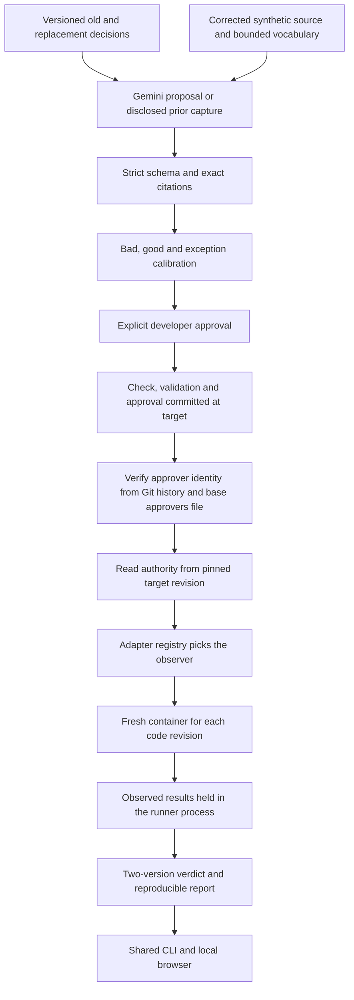

# Decision Drift Gate architecture

This document describes the approved design. [Phase status](phases/STATUS.md) records which components have actually passed verification.

AI proposes a check once. A developer calibrates and approves that exact proposal. Subsequent review results come from executing the approved check against fixed Git revisions; they do not require a model call.

## Authority and evidence

The target revision supplies decisions, checks, validation and approval. The proposed revision supplies the code being reviewed. Changes to policy at the proposed revision require policy review and make aggregate coverage incomplete; they cannot silently remove an existing check.

Canonical UTF-8 JSON and SHA-256 bind the check, governing decision, adapter version and validation. The approval record keeps a reviewer name and reason, but the name is only text. Who approved is decided from Git history; see [Approver identity](#approver-identity). The containing approval commit is recorded externally because a commit cannot contain its own final hash.

Proposal provenance records mode, model, capture time and source revision separately from its input-content digest. A real capture can be replayed only when the old/new decisions, corrected source and vocabulary match. Replay is labeled Recorded. A handwritten sample is labeled Manual.

## Bounded adapter

The first adapter runs trusted synthetic `src/job_client.py` with `submit_job(service, payload, operation_id)`. The fake service can create a job before returning 503, or reject it before creating one. Checks observe unique jobs and whether the returned ID actually exists. Completion is mandatory: avoiding duplicates by abandoning the operation does not pass.

Each revision executes in a fresh worker with a fresh service and a timeout. Unsupported source, missing entrypoints, crashes and malformed child output are errors. Model credentials are excluded from child environments. The fake service and all recorded events live in the runner process; the worker reaches it only through a JSON-line proxy (`ddg/worker.py`), so the revision under test cannot edit the evidence (regression-tested in `tests/test_harness.py`). A static screen rejects filesystem, process and network modules and `open`/`eval`/`exec`. That screen is best-effort and is not a security boundary; the container (below) is.

## Adapters

`ddg/adapters/__init__.py` holds a registry of modules. Each adapter module must define `NAME`, `validate_body`, `source_path`, `observe`, `ordinary` and `expected_case`; the registry refuses to import an adapter that lacks one. The engine collects the adapter names a run uses, and the adapter id is part of the approval digest.

| Adapter | Module | Observes |
|---|---|---|
| `python_job_client_v1` | `ddg/adapters/job_client.py`, runs `ddg/harness.py` | Jobs created and returned by `submit_job` in `src/job_client.py` against a fake service |
| `python_function_v1` | `ddg/adapters/python_function.py`, runs `ddg/worker_function.py` | Return value or exception type of one named function in one stdlib-only module, for JSON arguments (up to 50 cases) |

AI proposals support only `python_job_client_v1`. Checks for `python_function_v1` are written by hand.

## Sandbox

`ddg/sandbox.py` starts every worker. `DDG_SANDBOX` is `auto` (try Docker, then Podman), `docker`, `podman` or `host`. With no usable runtime, the run fails closed: the observation is an error and the verdict is NOT_CHECKED. `host` runs the worker as a plain subprocess with a small environment allowlist, and reports mark it UNSAFE.

The container uses no network, a read-only root, all capabilities dropped, `no-new-privileges`, a 64-process limit, 128 MB memory, 0.5 CPU and the user `65534:65534`. Source and worker are mounted read-only; `/tmp` is a 16 MB `noexec` tmpfs. The container is removed on timeout and on every other exit path. The image comes from `DDG_SANDBOX_IMAGE` (default `python:3.12-slim`). See the [threat model](THREAT_MODEL.md) for what this does not cover.

## Approver identity

`ddg/identity.py` reads `.ddg/approvers.json` from the **base** revision. The file has exactly `schema_version` (1), `require_signed` (boolean) and `approvers` (non-empty list of emails). For each approved check, the engine lists every commit that touched its check, validation and approval files, and requires for each commit:

- the author email is in `approvers` (case-insensitive);
- the commit changed only paths under `.ddg/checks/`, `.ddg/validations/` and `.ddg/approvals/`;
- if `require_signed` is true, Git reports signature status `G`.

A failure adds an `APPROVER_NOT_VERIFIED` warning and makes the aggregate INCOMPLETE. Missing history (a shallow clone) also fails. With no policy file, the run fails unless `DDG_ALLOW_UNVERIFIED_APPROVERS=1`. The identity of the approver is evidence in the report. This is as strong as the signing setup: author email alone can be forged.

## Result semantics

| Target | Proposed | Result |
|---|---|---|
| Pass | Fail | Violation introduced |
| Fail | Fail | Preexisting failure |
| Fail | Pass | Resolved |
| Pass | Pass | Approved check passed |
| Error | Any | Not checked |
| Any | Error | Not checked |

Missing authority, uncovered active decisions, policy edits and execution errors make the aggregate incomplete. Otherwise an introduced or preexisting failure makes it failed. A passed aggregate means the covered approved checks passed for the recorded revisions.

All active approved checks run on both revisions, including unrelated changes. Ordinary happy-path tests also execute; their badge is derived from observations. Changed lines provide review context rather than a claim of exact causal attribution.

## Local application

Python's standard library supplies Git orchestration, tests, subprocess execution, JSON persistence and the local HTTP server. Plain HTML, CSS and JavaScript display the same application functions as the CLI. Gemini's SDK is an optional dependency used only for live proposal generation.

The browser binds to loopback, uses a session action token and local-origin checks, bounds request bodies and serializes mutations. Session state and generated demo repositories are ignored by source Git. The source repository contains the fixture generator, not nested generated Git histories.

Live interactions have a 30-second caller deadline in addition to SDK network timeouts. A daemon worker transfers only a result or exception through a queue; a late response cannot create a proposal or mutate session state. The caller may make one repair interaction after invalid schema/citations. Provider failures are sanitized and require explicit Recorded selection rather than automatic fallback.
